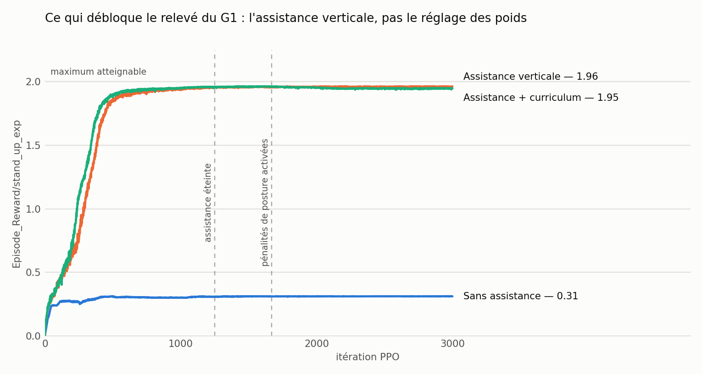
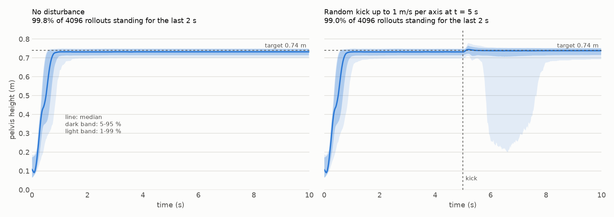
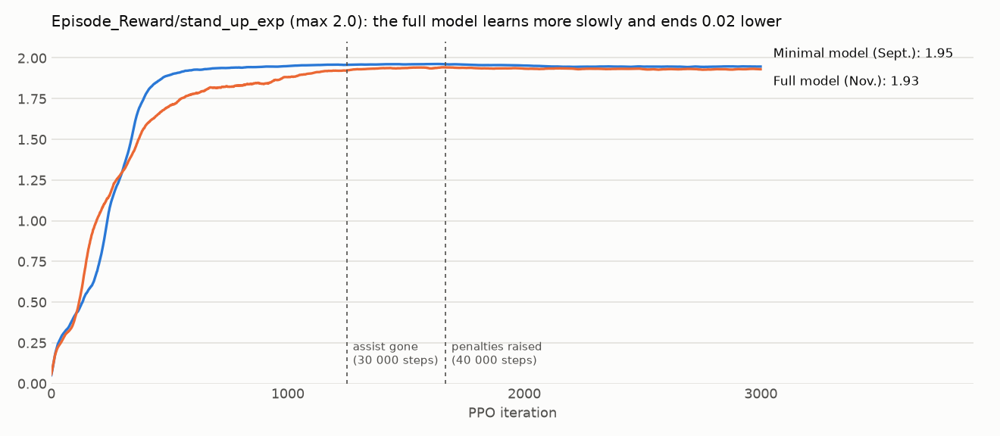

# G1 Fall Recovery

A Unitree G1 humanoid learning to stand back up from the ground, with reinforcement
learning in Isaac Lab.

The policy starts from a state a real fall produces (lying prone, supine or on its
side) and has ten simulated seconds to get its pelvis back to standing height and hold
it there.

<p align="center">
  
</p>

<p align="center"><em>Current policy (full collision model, real motor limits), deterministic inference, no assist
force. Simulated in Isaac Lab, replayed in MuJoCo (see <a href="#7-rendering-without-the-isaac-sim-renderer">stage 7</a>).</em></p>

## Result

Current policy, full collision model (run `2026-11-05_10-35-29`, checkpoint 2999):

| Metric | Value |
|---|---|
| Success rate, 4096 fallen states | **99.8%** standing (pelvis ≥ 0.65 m, upright) for the whole last 2 s |
| Time to stand | median 0.66 s, 90th percentile 0.76 s |
| Knocked down by a kick while standing | gets up again in 94% of cases, median 2.1 s after the kick |
| Pelvis height once standing (2 s to 10 s) | median 0.73 m (5th to 95th percentile 0.72 to 0.75 m), for a 0.74 m target |
| Horizontal drift once standing (2 s to 10 s) | median 4 mm, 95th percentile 18 cm |
| `stand_up_exp` (max 2.0) | 1.93 |
| Training cost | 3000 PPO iterations, ~295M simulated steps, ~80 min on one RTX 4090 (1.6 s per iteration) |

Details in [Evaluation](#evaluation).

The motion is robust but still far too fast and too hard: a real G1 takes several
seconds to get up, this policy takes under one, with the hips and shoulders at their
torque limit in four rollouts out of five. See [Next](#next).

<picture>
  <source media="(prefers-color-scheme: dark)" srcset="media/00-curves-dark.png">
  
</picture>

These curves come from the first version of the task (stages 1 to 5, minimal collision
model). The blue curve is the run without the assist force. With the same reward, the
same initial states and 3000 iterations of PPO, the robot never learns to stand up. The
assist curriculum is what unlocks the task, not the reward weights.

## Evaluation

`scripts/rsl_rl/evaluate.py` runs the final checkpoint headless on 4096 fallen states
from the bank, one full 10 s episode each, deterministic actions, no assist force, no
observation noise. A rollout counts as a success when the pelvis is at least 0.65 m high
and the base upright (`projected_gravity_b[:, 2]` ≤ −0.9) at every step of the last 2 s.

<picture>
  <source media="(prefers-color-scheme: dark)" srcset="media/12-eval-height-dark.png">
  
</picture>

### By fall type

The initial orientation is classified by the dominant axis of gravity in the pelvis
frame.

| Starting pose | Rollouts | Success | Median time to stand | 90th percentile |
|---|---|---|---|---|
| Prone (face down) | 1931 | 99.8% | 0.68 s | 0.74 s |
| Supine (on the back) | 1601 | 99.8% | 0.48 s | 0.54 s |
| On the side | 564 | 99.3% | 0.74 s | 0.88 s |
| **All** | **4096** | **99.8%** | **0.66 s** | **0.76 s** |

Lying on the back is the fastest start. Lying on the side is both the slowest and the
least reliable.

### Kicked while standing


The same 4096 rollouts, with a random horizontal velocity kick on the pelvis at t = 5 s,
up to 1 m/s on each axis (median 0.8 m/s, 95th percentile 1.2 m/s). The policy was
never trained with pushes.

| Kick speed | Rollouts | Knocked down | Standing at the end |
|---|---|---|---|
| < 0.5 m/s | 843 | 0.1% | 99.9% |
| 0.5 to 1 m/s | 2370 | 2.9% | 99.8% |
| 1 to 1.5 m/s | 883 | 14.9% | 99.0% |

201 robots (4.9%) were knocked down. 188 of them were standing again by the end of the
episode, a median 2.1 s after the kick, without ever having been trained to recover
from a fall that follows a push. The get-up skill generalises to falls the bank never
contained.

### How hard it pushes the motors

Peak joint torque and velocity over each rollout, as a fraction of the `G1_REAL_CFG`
limits (nominal run, body joints only):

| Joint group | Peak torque, median | Rollouts at the torque limit | Peak velocity, median |
|---|---|---|---|
| Hips | 100% | 79% | 67% |
| Shoulders | 100% | 81% | 34% |
| Ankles | 87% | 38% | 27% |
| Knees | 54% | 1% | 85% |
| Elbows | 49% | 1% | 26% |
| Torso | 46% | 1% | 30% |

In 96% of rollouts at least one joint hits its torque limit. The policy gets up by
saturating the hips and pushing off with the arms, which is why it is so fast. On
hardware that would be harsh on the gearboxes. The torques are the ones Isaac Lab
reports for implicit actuators: the PD law clipped at the limit, an estimate of what
PhysX applies.

## Setup

| | |
|---|---|
| Simulator | Isaac Lab 2.3.2 / Isaac Sim 5.1 |
| Robot | `G1_REAL_CFG` (`g1_cfg.py`): full `g1.usd`, 44 bodies, 37 DOF, self collision on, Unitree motor limits |
| Parallel envs | 4096 |
| Episode | 10 s, 500 steps at 50 Hz control, 200 Hz physics |
| Observations | 106: base linear and angular velocity, projected gravity, joint positions and velocities, last action |
| Actions | 23 joint position targets, the 14 finger joints excluded, per-joint scale |
| Algorithm | PPO (rsl_rl), actor and critic MLP `[512, 256, 128]`, ELU |
| Terrain | flat plane |

Only `time_out` ends an episode. There is no early termination on purpose: on a get-up
task, a contact-based termination fires on the state the robot is supposed to recover
from.

### Reward

One term carries the objective:

```python
stand_up_exp = exp(-(h - 0.74)² / 0.5² - (g_z + 1)² / 1.0²)      # weight 2.0
```

`h` is the pelvis height, `g_z` the vertical component of gravity in the base frame
(−1 upright, 0 on the side, +1 upside down).

The two halves are multiplied rather than added, which matters (see stage 1).

The rest is shaping and regularisation: `track_height` and `upright_exp` at weight 0.25
so both halves stay readable in the logs, plus posture and smoothness penalties
introduced by curriculum.

## How it got there

### 1. Additive rewards, and reward hacking


Height and uprightness were two separate reward terms, added together. The policy
converged to `upright_exp` = 0.96 out of 1.0 while `track_height` stayed at 0.12. It had
found a pose that collects the uprightness reward without lifting its own weight:
sitting on the floor, legs splayed, torso vertical.

That is 44% of the available task reward for no effort, and the saturated term gave no
gradient to do better.

Fix: multiply the two kernels instead of adding them. Upright while flat on the floor
then scores as poorly as lying down at the right height.

### 2. Multiplicative reward, and the exploration wall


The exploit was gone and the robot learned nothing. Between iteration 930 and 2057, so
110M simulated steps, `stand_up_exp` moved by 0.0006. Standing up is a coordinated two
to three second motion, and Gaussian noise on 23 joints does not find it.

### 3. A bank of real fallen states

Spawning the robot in mid-air with a random orientation taught it to catch itself when
dropped, which is not the same task.

`scripts/make_fallen_bank.py` drops 512 robots from 0.9 m with random orientations and
random held joint targets, lets physics settle them for five seconds, and records the
resulting root pose and joint configuration. Eight rounds give 4096 states, sampled at
every reset.

### 4. The upward assist curriculum

Taken from HoST: hold the robot up early so it can reach and be rewarded for standing
states, then remove the help.

An external force is applied to `torso_link` in the world frame (the robot starts lying
down, so "up" cannot be the body frame), worth 80% of body weight, annealed linearly to
zero over the first 30 000 environment steps, around iteration 1250.

That change took `stand_up_exp` from 0.31 to 1.96. The policy stands unaided for the
last 1750 iterations, after the assist is gone.

### 5. Posture penalties, introduced by curriculum


The robot stood up, but twitched and wandered off. Penalties on horizontal velocity,
foot slide, torso rotation and action rate fixed that, but only once they were
introduced after the get-up was already learned.

Applied from step zero they collapsed the run: staying still became cheaper than
moving, the action noise std fell from 0.85 to 0.13, entropy went negative, and the
policy settled back onto the floor.

`CurriculumCfg` switches each penalty on at 40 000 steps via `modify_reward_weight`, and
`entropy_coef` went from 0.008 to 0.015. Final `stand_up_exp` is 1.95 instead of 1.96.

### 6. The real robot: full collisions and motor limits

The stage 5 policy looked good in numbers and wrong on video: the robot was up in under
a second, with motions no real G1 could make. The cause was the robot model, not the
reward. Isaac Lab's `G1_MINIMAL_CFG` is built for walking:

- only the two feet and the torso carry colliders (checked in the USD with `usd-core`),
  so the legs, pelvis and arms could sink through the floor and push off from inside it;
- self collision is off, so limbs fold through each other;
- every hip, knee, shoulder and elbow gets 300 Nm and no joint has a speed limit.

`g1_cfg.py` replaces it with `G1_REAL_CFG`:

| | `G1_MINIMAL_CFG` | `G1_REAL_CFG` |
|---|---|---|
| Bodies with colliders | 3 of 44 | 38 of 44 |
| Self collision | off | on |
| Torque limits | 300 Nm on hips, knees, shoulders, elbows | 88 Nm (hip pitch/yaw, torso), 139 Nm (hip roll, knee), 35 Nm (ankles), 25 Nm (arms), from Unitree's URDF |
| Velocity limits | none | 20 to 37 rad/s, from Unitree's URDF |
| PD gains | Isaac Lab defaults | from each motor's reflected inertia, 10 Hz natural frequency and damping ratio 2, as in `unitree_rl_lab` |
| Action scale | 0.5 for every joint | per joint, so that a unit action asks for a quarter of that joint's torque limit |

The smoothness penalties were also strengthened: a new joint velocity penalty
(`dof_vel_l2`), and torque, acceleration and action-rate weights that start low and are
raised by the curriculum at 40 000 steps. With a discount of 0.99, every step spent on
the floor costs reward, so these penalties are the only thing that stops the policy from
getting up as violently as the motors allow. The fallen-state bank was rebuilt with the
full model, ignoring the six links that carry no collider when measuring ground
clearance.

<picture>
  <source media="(prefers-color-scheme: dark)" srcset="media/10-curves-models-dark.png">
  
</picture>

Result: `stand_up_exp` 1.93, against 1.95 for the minimal model, a clean stand with no
penetration, and a stable hold. The full model learns more slowly: with real torque
limits, the policy needs about 1000 iterations instead of 500 to reach 1.9. But the
get-up itself still takes 0.6 to 0.8 s:


<em>The first two seconds of one rollout, slowed down 4x.</em>

The reward explains it. `stand_up_exp` pays the same at every step once the robot is
up, so the earlier it gets there the more it collects, and the penalties are not large
enough to outweigh that: the hips and shoulders still hit their torque limit in four
rollouts out of five (see [Evaluation](#how-hard-it-pushes-the-motors)). The next step is a target height that rises over time, so
there is nothing to gain from arriving early.

### 7. Rendering without the Isaac Sim renderer

Isaac Sim 5.1 is validated on NVIDIA driver 580. By November 2026 every GPU host on
Runpod ran driver 595 (CUDA 13.2), on which the RTX renderer segfaults at startup in
`librtx.scenedb`. Headless training is unaffected, but `play.py --video` cannot run.

The workaround splits simulation and rendering:

1. `scripts/rsl_rl/record_poses.py` runs the policy headless in Isaac Lab and logs, at
   every policy step, the root position (minus each env's grid origin), the root
   quaternion and the 37 joint angles to a `.npz`.
2. `scripts/replay_mujoco.py` loads the G1 from MuJoCo Menagerie, places it in each
   recorded pose with `mj_forward` (kinematics only, no physics) and writes the mp4. It
   runs on a laptop with no NVIDIA GPU.

This is a kinematic replay: the motion is exactly what Isaac Lab simulated. One catch:
Isaac Lab's G1 is the older 37-DOF model (one `torso_joint`, elbow pitch and elbow roll,
Dex3 fingers) while Menagerie ships the current 29-DOF one (three waist joints, elbow
and three wrist joints, no fingers). `replay_mujoco.py` maps the old joint names onto
the new ones and leaves the 14 finger joints out, so the silhouette differs slightly
from the simulated robot, but every body joint is driven.

It is also the first half of a sim-to-sim check: the joint naming, quaternion order
and root offsets now line up between the two simulators.

## Training progression

Clips from the stage 5 run, evenly spaced. These show training behaviour, so the
actions carry exploration noise. The deployed policy is smoother.

| Step 0, assist at full strength | Step 20 000, assist fading |
|---|---|
|  |  |

| Step 40 000, unaided, penalties switching on | Step 70 000, converged |
|---|---|
|  |  |

## Reproducing

```bash
# with a Python interpreter that has Isaac Lab installed
python -m pip install -e source/g1_fall_recovery

# 1. record the fallen-state bank (a few minutes)
python scripts/make_fallen_bank.py --headless

# 2. train (~80 min on an RTX 4090)
python scripts/rsl_rl/train.py --task Template-G1-Fall-Recovery-v0 --headless

# 3. play the result and export the policy to TorchScript / ONNX
#    (add --video if your NVIDIA driver is on the R580 branch)
python scripts/rsl_rl/play.py --task Template-G1-Fall-Recovery-v0 --headless --num_envs 4

# 4. log the poses of 4 rollouts to <run dir>/poses.npz
python scripts/rsl_rl/record_poses.py --task Template-G1-Fall-Recovery-v0 --headless \
  --num_envs 8 --checkpoint logs/rsl_rl/g1_fall_recovery/<run>/model_2999.pt

# 5. evaluate on 4096 fallen states, then again with a kick at t = 5 s (~3 min each);
#    --export also writes exported/policy.onnx and policy.pt next to the checkpoint
python scripts/rsl_rl/evaluate.py --task Template-G1-Fall-Recovery-v0 --headless --num_envs 4096 \
  --checkpoint logs/rsl_rl/g1_fall_recovery/<run>/model_2999.pt --export --output eval_nominal.npz
python scripts/rsl_rl/evaluate.py --task Template-G1-Fall-Recovery-v0 --headless --num_envs 4096 \
  --checkpoint logs/rsl_rl/g1_fall_recovery/<run>/model_2999.pt --push 1.0 --output eval_push1.npz
```

The plots are made offline from those files and the TensorBoard logs:

```bash
pip install matplotlib tensorboard
python scripts/analysis/plot_eval.py eval_nominal.npz eval_push1.npz media/
python scripts/analysis/plot_training.py logs/rsl_rl/g1_fall_recovery media/
```

The `.npz` files written by `evaluate.py` also hold the full poses of their first 64
rollouts, so `replay_mujoco.py` reads them directly (`--start` and `--end` cut a clip).

Then, on any machine:

```bash
pip install mujoco "imageio[ffmpeg]" numpy
git clone --depth 1 --filter=blob:none --sparse https://github.com/google-deepmind/mujoco_menagerie
(cd mujoco_menagerie && git sparse-checkout set unitree_g1)

python scripts/replay_mujoco.py poses.npz --mjcf mujoco_menagerie/unitree_g1/scene.xml --env 0
```

The fallen-state bank (`mdp/fallen_states.pt`) is not committed, so step 1 is required.

The GIFs are stored with Git LFS. Run `git lfs install` before cloning, or they arrive
as text pointer files.

## Layout

```
scripts/
  make_fallen_bank.py            # records the bank of settled fallen states
  replay_mujoco.py               # renders a .npz of recorded poses to mp4 in MuJoCo
  rsl_rl/train.py, play.py
  rsl_rl/record_poses.py         # runs a checkpoint headless and logs root pose + joint angles
  rsl_rl/evaluate.py             # success rate, timing, motor usage over 4096 fallen states, optional kick
  analysis/plot_eval.py          # pelvis height distribution plot from evaluate.py output
  analysis/plot_training.py      # training curves from TensorBoard logs
source/g1_fall_recovery/g1_fall_recovery/tasks/manager_based/g1_fall_recovery/
  g1_fall_recovery_env_cfg.py    # scene, observations, rewards, events, curriculum
  g1_cfg.py                      # G1_REAL_CFG: full collisions, Unitree motor limits and gains
  mdp/rewards.py                 # stand_up_exp, track_height, upright_exp, base_lin_vel_xy_l2
  mdp/events.py                  # reset_from_fallen_bank, apply_upward_assist
  agents/rsl_rl_ppo_cfg.py
```

## Next

- Slow the get-up down to a realistic pace: a target height that ramps up over time, so
  the policy gains nothing from arriving early, and a penalty on time spent at the
  torque limit rather than on torque squared.
- Train with pushes. Recovery after a kick already works in 94% of falls without it.
- Full sim-to-sim validation: run the exported policy in MuJoCo physics, not just a
  kinematic replay, before anything touches hardware.
- Rough terrain. The flat plane was chosen to separate getting up from handling the ground.
- A wider bank. The current one is built from free-fall drops only, not from falls that
  follow a push during locomotion.
